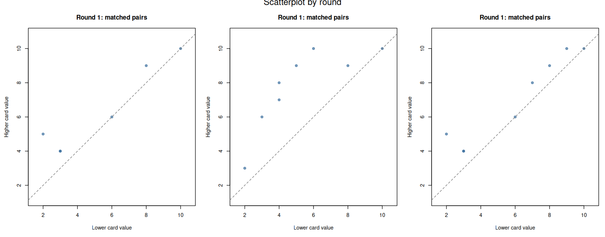
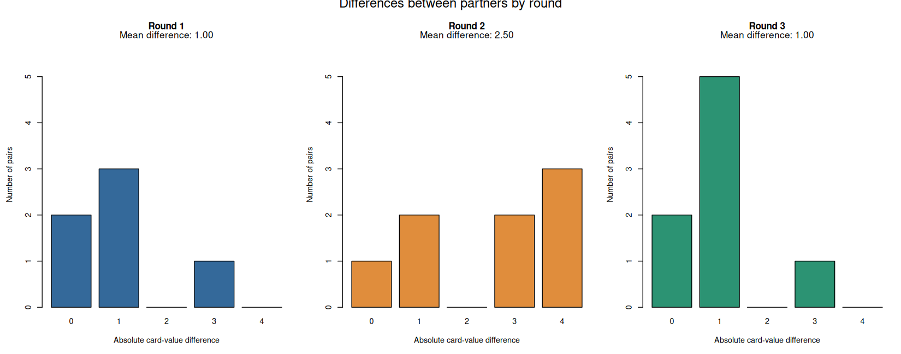
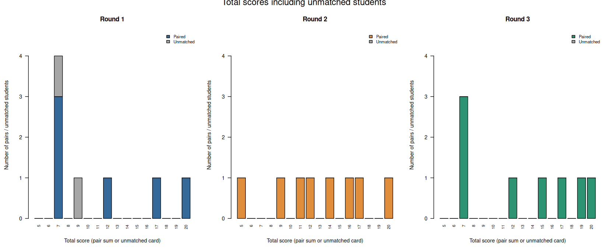

---
format:
  revealjs:
    theme: simple
    transition: none
    center: false
    incremental: false
    embed-resources: true
---

<!-- ## Choose a Side -->

<!-- * Group based on card color: black is pro, red is contra -->
<!-- * 5 minutes to prepare a strong case and assign two speakers -->
<!-- * Black: 2 minutes to make your case -->
<!-- * Red: 2 minutes to make your case -->
<!-- * 5 minutes to prepare rebuttal -->
<!-- * Black: 2 minutes to make your case -->
<!-- * Red: 2 minutes to make your case -->

<!-- ## Discussion rules {.smaller} -->

<!-- 1. Listen respectfully and fully with the intention to understand -->
<!-- 2. Assume good intentions -->
<!-- 3. Challenge ideas, not people -->
<!-- 4. Acknowledge previous ideas and build on them -->
<!-- 5. Step up, then step back: speak your mind, then give everyone else a chance to speak -->
<!-- 6. When you notice that you are making assumptions, ask a question -->
<!-- 7. Take responsibility for your statements: Speak in the first person (I think, I notice), bring the evidence for your claims -->
<!-- 8. Focus on what can be learned, not on "winning" the debate -->
<!-- 9. If you respond emotionally to the topic of the discussion, express it -->
<!-- 10. Pass the microphone to the first person with a hand up to your left (end of the room: start again on other side) -->


<!-- ## Discussion statement -->

<!-- > A psychological theory that cannot be translated into a mathematical or computational model is not a sufficiently developed scientific theory. -->

```{r echo = FALSE}
source("analyze_mating.R")
```

## Become an Agent-Based Model, Round 1

* Don't look at your card
* Find the highest-value partner who is willing to pair with you
* A handshake is binding: if you shake hands, you're paired
* Pairs exit the dating market, come to me
* Speaking is not allowed
* You have 90 seconds, like musical chairs: freeze when the alarm rings!

Afterwards, singles show me your card values

## Round 2

* Pairs stay in the market until the end of the game
* Handshakes are not binding

## Round 3

* Look at your card before the game starts

## Analyze scatter



## Analyze differences



## Analyze differences: total scores



## Formalize the Model

* Groups of 3/4
* Take your experience from the mating game, and *design* a model that could, in principle, be programmed
* Design means: You don't have to define every rule
* You can write statements, use pseudocode, draw a flowchart - whatever you like
* Then, present

## Question the Model

Suggested phrasing of your questions:

"What I learned from your model is X, what I still wonder about is Y"

Suggested lines of enquiry:

1. What aspects of the exercise do you miss?
1. Which assumptions are unrealistic or unjustified?
1. When would the model likely fail/what would break it?

## Reflection

1. What did you learn about formal modeling?
2. Which activity or reading most did you find most informative?
3. What is one unresolved question you have about formal modeling?
